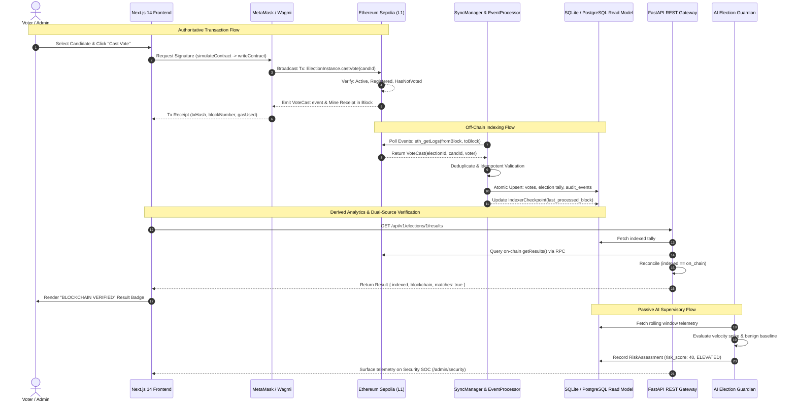
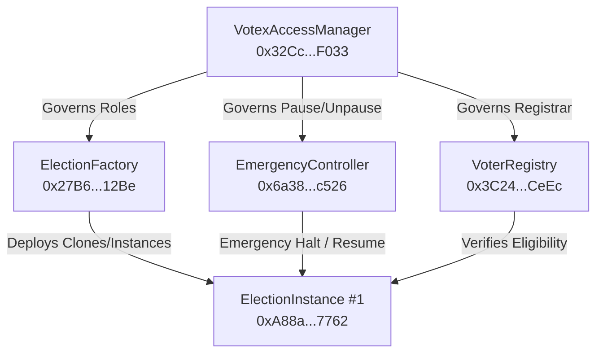
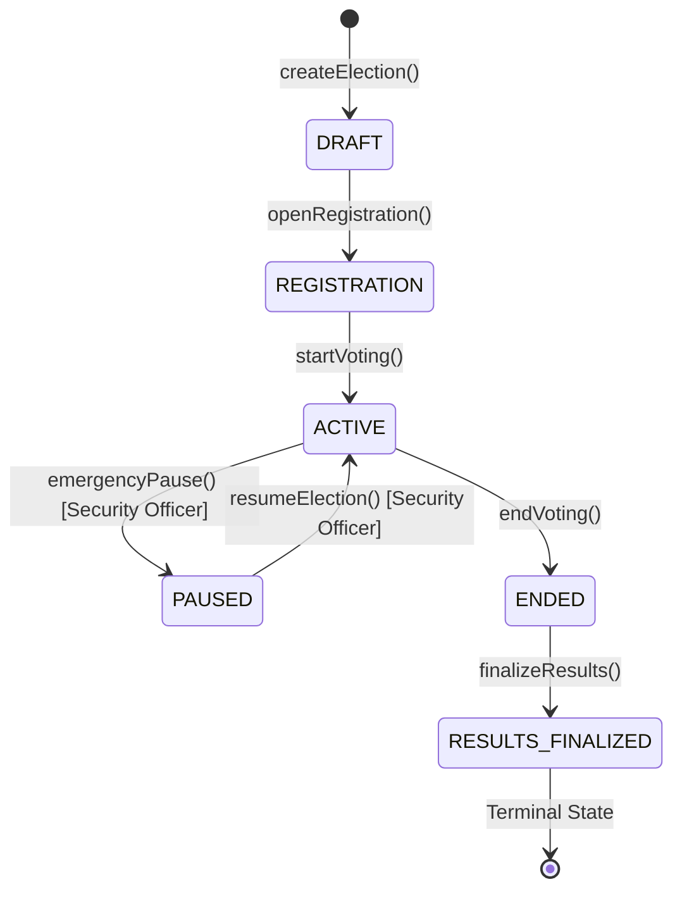

# VOTEX — System Architecture Specification

## 1. System Overview & Trust Hierarchy

VOTEX is a decentralized e-voting and election governance platform engineered as an academic research prototype. It couples Ethereum smart contracts with an event-driven off-chain indexer, a FastAPI REST gateway, and a Next.js 14 web client, overseen by a passive AI Election Guardian.

The architecture enforces a strict three-tier trust classification:

```
┌─────────────────────────────────────────────────────────────────────────────┐
│                            VOTEX TRUST HIERARCHY                           │
├────────────────────────────────┬────────────────────────────────────────────┤
│ TIER 1: AUTHORITATIVE          │ Ethereum Sepolia Smart Contracts           │
│ (Immutable Source of Truth)    │ • Vote tallies, eligibility commitments    │
│                                │ • Election state machine transitions       │
│                                │ • Role-based access control (RBAC)         │
├────────────────────────────────┼────────────────────────────────────────────┤
│ TIER 2: DERIVED                │ Backend Indexer & Database Read Model      │
│ (Off-Chain Analytics View)     │ • Normalized event log (SyncManager)       │
│                                │ • Read-optimized SQL projections           │
│                                │ • Dual-source audit & reconciliation API   │
├────────────────────────────────┼────────────────────────────────────────────┤
│ TIER 3: ADVISORY               │ AI Election Guardian                       │
│ (Passive Telemetry Monitor)    │ • Velocity spikes & statistical anomalies  │
│                                │ • Risk scores & explainability factors     │
│                                │ • STRICTLY SUPERVISORY — ZERO STATE WRITE  │
└────────────────────────────────┴────────────────────────────────────────────┘
```

> [!IMPORTANT]
> The backend database and AI Guardian are strictly read-only replicas and monitors. Vote validity and winner certification are determined **exclusively** by the smart contracts deployed on Ethereum Sepolia.

---

## 2. Complete End-to-End Data Flow

The following Mermaid diagram outlines the complete lifecycle of transactions and telemetry through the VOTEX system:



---

## 3. Smart Contract Architecture

The smart contract subsystem is authored in Solidity 0.8.24 using OpenZeppelin v5 abstractions, deployed on Ethereum Sepolia (Chain ID 11155111):



### 3.1 Contract Responsibilities

1. **`VotexAccessManager`**:
   - Manages role grants and revocations with hierarchical administration.
   - Roles: `DEFAULT_ADMIN_ROLE`, `ELECTION_MANAGER_ROLE`, `VOTER_REGISTRAR_ROLE`, `SECURITY_OFFICER_ROLE`, `AUDITOR_ROLE`.
2. **`VoterRegistry`**:
   - Maintains blinded voter credential commitments (`bytes32 commitment = keccak256(voterAddress, secret)`).
   - Enforces unique registration and active voter status.
3. **`ElectionFactory`**:
   - Deploys and catalogs individual `ElectionInstance` contracts.
   - Emits `ElectionCreated(electionId, creator, title, contractAddress)`.
4. **`ElectionInstance`**:
   - Manages the election state machine and candidate roster.
   - Executes atomic vote recording with instant duplicate rejection: `revert AlreadyVoted(electionId, voter)`.
5. **`EmergencyController`**:
   - Implements circuit-breaker controls callable only by accounts holding `SECURITY_OFFICER_ROLE`.
   - Allows instant pause of an active election if an anomaly is detected, and resumption after review.

### 3.2 Election State Machine

State transitions are strictly linear and terminal:



---

## 4. Off-Chain Indexer & Read Model

The backend indexer bridges the authoritative blockchain state into a high-performance relational database (PostgreSQL 16 in production, SQLite for local evaluation).

### 4.1 SyncManager & EventProcessor

- **Block Cursor Tracking**: The `indexer_state` table records the latest contiguous block scanned (`last_block`). Re-scans start safely from `last_block + 1`.
- **Chunked Polling**: Public Sepolia RPC providers impose block range limits (typically 10–50 blocks). The `SyncManager` divides scan intervals into safe chunks (default: 10 blocks) with exponential backoff on HTTP 429/504 errors.
- **Event Idempotency**: Each on-chain event is assigned a deterministic natural key:
  $$\text{dedup\_key} = \text{keccak256}(\text{tx\_hash} \parallel \text{log\_index})$$
  Re-indexing previously scanned blocks updates existing records without creating duplicates (`events_skipped > 0`, `events_indexed = 0`).

### 4.2 Reorganization (Reorg) Handling

Public testnets occasionally experience temporary chain reorganizations (1–3 blocks):
- The indexer buffers events behind a configurable confirmation threshold (`INDEXER_CONFIRMATIONS=2`).
- If a block hash mismatch occurs between the local record and the remote provider, the indexer rolls back unconfirmed blocks and re-scans from the last finalized ancestor.

---

## 5. Dual-Source Verification Engine

To ensure transparency, the FastAPI gateway provides an automated verification endpoint (`GET /api/v1/elections/{id}/results`):

1. **Indexed Read**: The API reads vote totals and candidate tallies from the local relational database.
2. **On-Chain Query**: Concurrently, the API executes a live RPC call (`getResults()` and `getWinner()`) directly against the `ElectionInstance` smart contract on Ethereum Sepolia.
3. **Reconciliation**:
   - If both tallies match exactly: `matches: true, differences: []`.
   - The frontend renders the green **`BLOCKCHAIN VERIFIED`** seal.
   - If a discrepancy occurs (e.g. indexer lag or database corruption): `matches: false`, and an alert is raised.

---

## 6. AI Election Guardian Boundary

The AI Election Guardian operates under a strict **supervisory-only architectural boundary**:

```
┌─────────────────────────────────────────────────────────────┐
│                    AI GUARDIAN BOUNDARY                     │
│                                                             │
│   ALLOWED (Passive Telemetry):                              │
│   ✔ Read indexed events and compute rolling velocities     │
│   ✔ Calculate statistical z-scores against rolling window   │
│   ✔ Generate risk scores (0–100) and threat levels         │
│   ✔ Expose explainability factors via /admin/security API   │
│                                                             │
│   FORBIDDEN (Hard System Invariants):                       │
│   ✖ CANNOT sign or broadcast blockchain transactions       │
│   ✖ CANNOT alter vote counts or election tallies           │
│   ✖ CANNOT trigger emergency pause autonomously            │
│   ✖ CANNOT invalidate votes or alter candidate standings    │
└─────────────────────────────────────────────────────────────┘
```

Any operational intervention (such as an emergency pause) requires an authenticated human operator holding the `SECURITY_OFFICER_ROLE` to manually submit a transaction through the `EmergencyController`.

---

## 7. Frontend Client Architecture

The frontend is implemented with Next.js 14 (App Router), Tailwind CSS, and Wagmi v2 / Viem:

- **Layered Access**: UI components never interact with raw RPCs. All contract reads and writes are encapsulated within custom React hooks (`useElection`, `useVoting`, `useAdminRoles`, `useResults`, `useGuardian`).
- **Resilient RPC Fallback**: To safeguard against public Sepolia rate limits, Wagmi is configured with Viem `fallback([http("https://ethereum-sepolia-rpc.publicnode.com"), http("https://1rpc.io/sepolia")])`.
- **RBAC Gate Enforcement**: All administrative views (`/admin/*`) are guarded by `AdminGuard`, which inspects real on-chain role assignments from `VotexAccessManager`. Unauthenticated or unauthorized visitors are halted by access gate cards.
- **Terminal State UI**: When an election enters `RESULTS_FINALIZED`, voting action controls are cleanly replaced with read-only audit badges, and the certified winner is highlighted.
